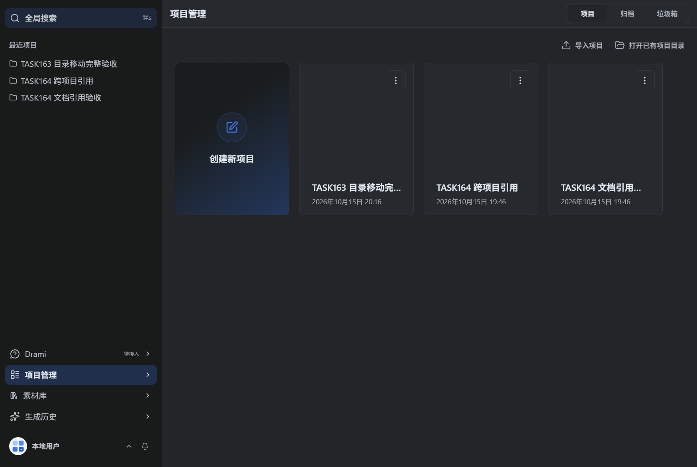
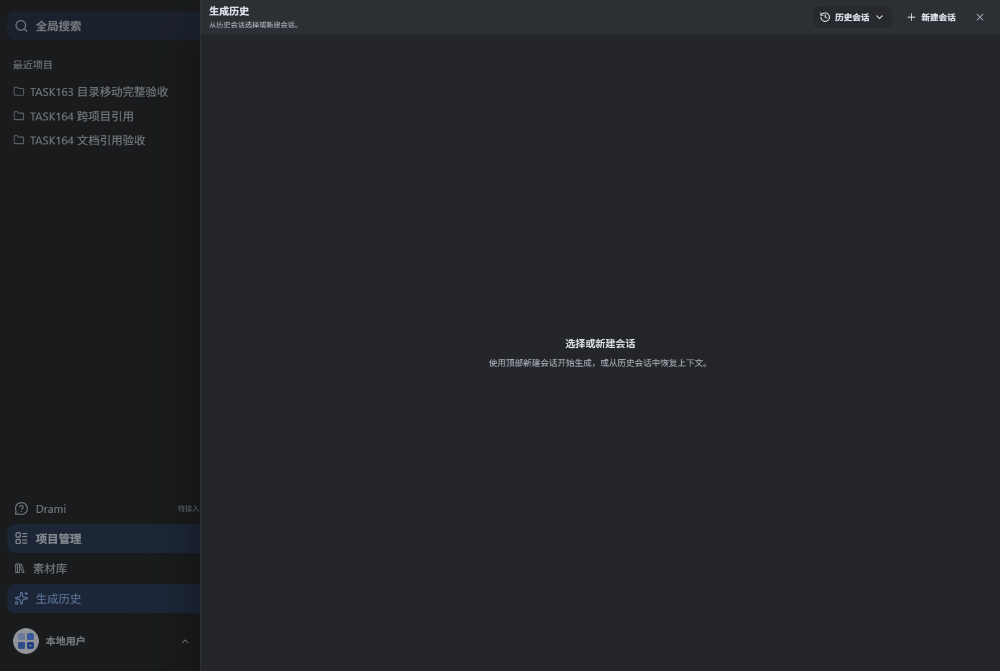
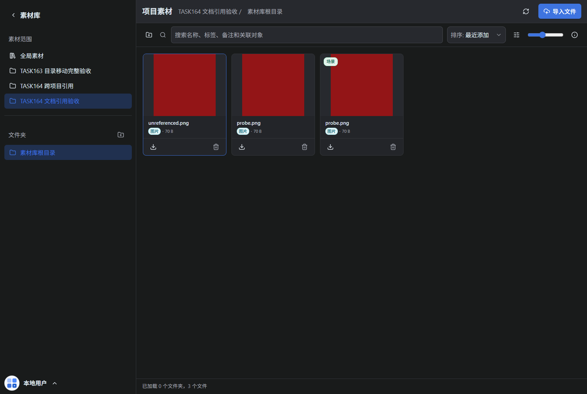
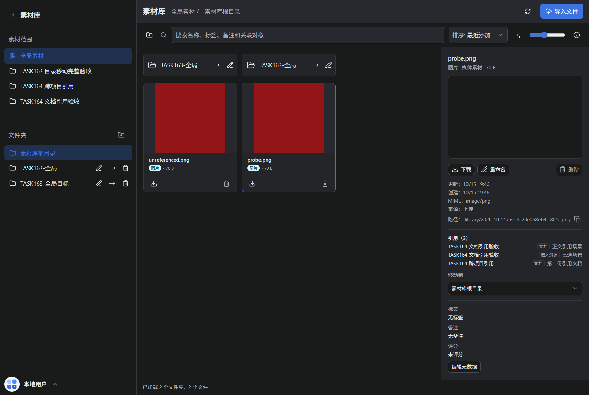
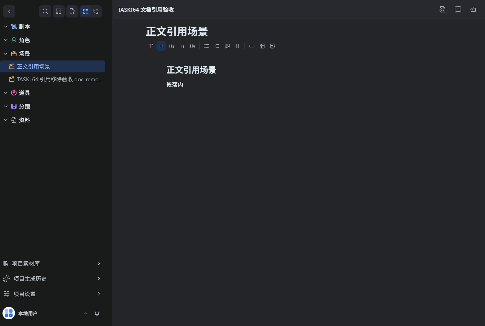

# 素材引用从哪来：界面走查流程（附截图）

> 走查环境：本地隔离实例 `http://localhost:31433`（前端）+ `31432`（后端）。
> 本文截图来自早期隔离环境。2026-10-16 已实际验收：文档章节的图片生成弹窗可通过「从素材库中选择」导入本地图片，再在历史卡片点「选入结果」，无需调用模型。采用后来源为 imported，关闭重开不重复写入。真实供应商生成仍待接入；资源栏当前显示章节文本摘要，图片停留时间轴另属 TASK-178。

## 1. 首页：三个相关入口

左侧导航自下而上有三个入口：**项目管理**、**素材库**、**生成历史**。



| 入口 | 作用 |
| --- | --- |
| 项目管理 | 项目列表，点进项目才有文档（剧本/角色/场景/道具/分镜） |
| 素材库 | 全部素材 + 各项目素材，点素材卡片看详情和「引用 (n)」 |
| 生成历史 | 生成工作台：新建会话生成图片/视频/音频，结果卡片上有「选入」 |

## 2. 「选入」在哪：生成历史（当前为空态）

左侧导航点「生成历史」。正常流程是：右上角「新建会话」→ 生成图片/视频 → **每条生成结果卡片上出现「选入」按钮**，点它就把该结果选入当前项目。



旧截图显示「选择或新建会话」，只代表当时会话为空。当前可从文档章节打开图片弹窗，选择本地素材导入历史，再勾选「选入结果」；本地导入不计为供应商调用。取消选入只删除采用关系，保留素材文件。

> 补充：进入某个项目后，左下角还有项目级入口「项目生成历史」，与全局「生成历史」同理，只是会话归属该项目。

## 3. 选入之后去哪看：素材库的「项目素材」

素材库 → 左侧「素材范围」选择具体项目（如 TASK164 文档引用验收）。列表里**带分类角标（如「场景」）的卡片就是已选入的生成资源**；普通「图片」角标的是直接上传的媒体素材。



上图中第三张 `probe.png`（带「场景」角标）就是一条已选资源。对它可执行「取消选入」：只移除选入关系，不删原始素材。

## 4. 引用计数在哪看：素材详情面板

在素材库点任意素材卡片，右侧详情面板列出「引用 (n)」，每条形如「项目名 + 来源标注 + 资源名」：



截图中 `probe.png` 的 3 条引用正是两种来源的合并：

1. TASK164 文档引用验收 · **文档** · 正文引用场景 —— 该文档正文内嵌了这张图的 Markdown 图片；
2. TASK164 文档引用验收 · **选入资源** · 已选场景 —— 该素材被选入过这个项目；
3. TASK164 跨项目引用 · **文档** · 第二份引用文档 —— 另一个项目的文档也内嵌了它。

同一项目可以同时占两条（选入 + 文档各算一条）。

## 5. 「文档」引用怎么产生：项目文档正文插图

项目管理 → 点进项目 → 左侧文档树（剧本/角色/场景/道具/分镜/资料）→ 打开文档。在编辑器里通过 `@` 提及选择素材图片，或把生成结果采纳进章节，正文就会插入一行 Markdown 图片：

```markdown

```



保存后，后端扫描所有进行中项目的文档正文，识别到这类 URL 就在引用面板记一条「文档」来源；把正文那行图删掉再保存，引用随即消失。注意：`@标题](mention://…)` 这种文档提及**不算**素材引用，章节占位图也不算。

## 6. 完整流程串一遍

```text
生成历史 → 新建会话 → 生成图片/视频
        → 结果卡片点「选入」            ……产生「选入资源」引用
        → 素材库（项目范围）看到带角标的已选卡片

项目 → 文档 → @提及插图 / 采纳生成结果到章节
        → 正文落 Markdown 图片          ……产生「文档」引用

素材库 → 点素材卡片 → 详情面板「引用 (n)」 = 两种来源合并计数
```

**删除前自查**：目前删除被引用的素材没有拦截，引用面板就是给你删前核对用的——若仍有「文档」引用，删除后对应文档里的图片会变成死链。
